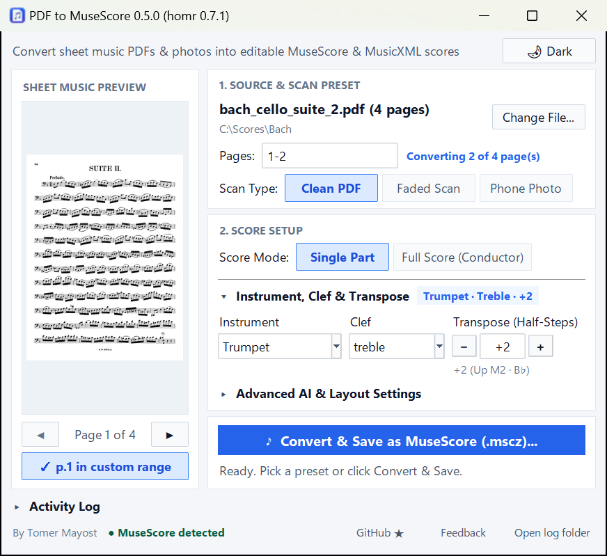
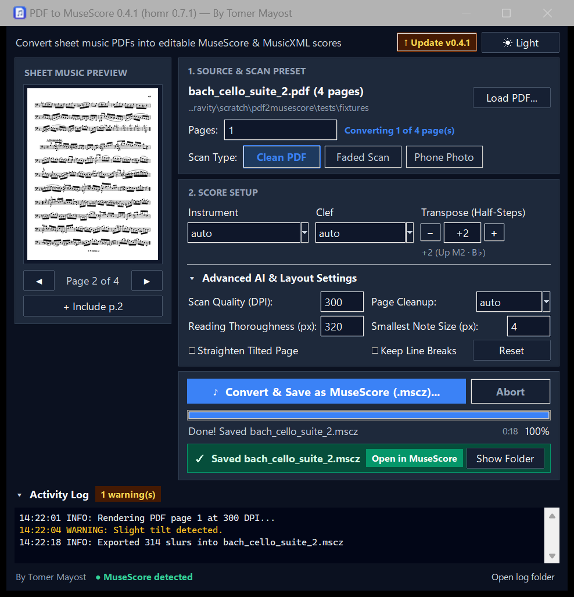
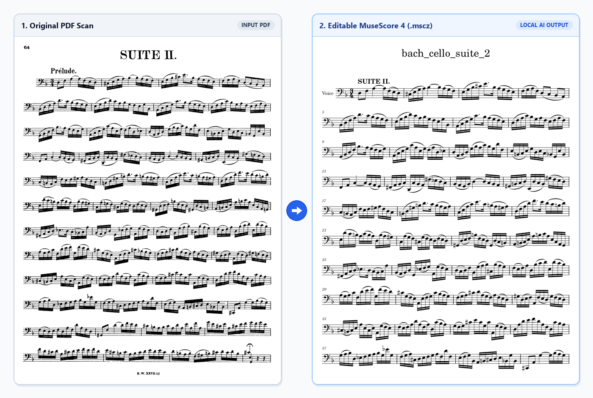

# PDF to MuseScore

[](https://apps.microsoft.com/detail/9N6NCBWM3BHT)
[](https://github.com/tomermayost/pdf2musescore/releases/latest)
[](LICENSE)
[](#download--installation-no-python-or-java-required)
[](https://github.com/tomermayost/pdf2musescore/actions/workflows/release.yml)
[](https://github.com/liebharc/homr)

**By Tomer Mayost**

Convert sheet music PDFs and photos (`.png`, `.jpg`, `.webp`, `.bmp`, `.tif`) into editable **MuseScore 4 (`.mscz`)** and **MusicXML (`.musicxml`)** files — **100% free, runs locally on your PC, no account, no page limits, and no Python or Java setup**.

> 👉 **[Get it from Microsoft Store (Recommended — Signed, Zero SmartScreen)](https://apps.microsoft.com/detail/9N6NCBWM3BHT)** · **[Standalone `.exe` Installer (Latest Release)](https://github.com/tomermayost/pdf2musescore/releases/latest)** · 🌐 **[Website](https://tomermayost.github.io/pdf2musescore/)** · **[All Releases & Checksums](https://github.com/tomermayost/pdf2musescore/releases)** · **[Ask Questions in Discussions](https://github.com/tomermayost/pdf2musescore/discussions)**



<details>
<summary>Preview Dark Studio Theme &amp; Advanced AI Settings Drawer</summary>



</details>

---

## Real Conversion Example (Before → After)

Converted directly on local CPU from the public-domain **Bach Cello Suite No. 2 (Prélude)** scan into an editable `.mscz` score opened in MuseScore 4:



Notice how `pdf2musescore` preserves the **bass clef, D minor key signature (B♭), 3/4 time signature, slurs, ties, stems, beams, and flowing measure layout** (stripping forced PDF line breaks and sanitizing slurs/tuplets/tremolos so MuseScore 4 imports cleanly).

---

## Why PDF to MuseScore?

| Feature | **PDF to MuseScore** | MuseScore Online Import | Audiveris | Paid Scanners *(PlayScore 2 / ScanScore / PhotoScore)* |
|---|---|---|---|---|
| **Price** | **100% Free & Open Source** | Free tier capped / Pro needed | Free & Open Source | Paid / Subscription |
| **Account Required?** | **No** | Yes (MuseScore.com) | No | Usually / License key |
| **Privacy / Offline** | **100% Local on CPU** | Uploads PDF to cloud | Local | Local or cloud |
| **Page / Score Limits** | **Unlimited** | Limited on free tier | Unlimited | Page limits on trials |
| **Windows Setup** | **Microsoft Store (1-Click) or `.exe` Installer** | Built into MuseScore | Requires Java runtime | Standard installer |
| **Direct `.mscz` Output** | **Yes** *(plus `.musicxml`)* | Yes | Exports MusicXML first | Exports MusicXML first |
| **Transpose & Clef Fix** | **Built-in before export** | Edit after import | Edit after import | Varies |

---

## Key Features

- **Direct Image Input & Drag-and-Drop:** Drop a PDF or sheet-music photo (`.png`, `.jpg`, `.webp`, `.bmp`, `.tif`) straight onto the window — smartphone EXIF rotation and transparent PNGs are handled automatically.
- **Live Sheet-Music Preview & Interactive Page Picker:** Flip through PDF pages (`◀` / `▶` or `←` / `→`) inside the app and click **Pick / Include page** (or type ranges like `2-3, 5`) to convert only the movements or pages you need.
- **One-Click Scan Presets:** Choose **Clean PDF**, **Faded Scan** (enhances light photocopies + auto-deskews), or **Phone Photo** (adaptive shadow removal + auto-deskew) — no guesswork required.
- **Musician-First Score Setup:** Pick **Instrument**, override **Clef**, or **Transpose** (`−` / `+` half-steps with live musical hints like `+2 (Up M2 · B♭)` for trumpet/clarinet/tenor sax) before opening in MuseScore.
- **MuseScore 4 Sanitization & Unicode Path Safety:** Cleans unclosed slurs, malformed tuplets, and problematic tremolos from raw OMR output, sets the score title from your saved filename, and handles non-ASCII folders reliably.
- **Powered by `homr` 0.7+ Deep-Learning AI:** Runs ONNX Runtime locally on CPU — recognizing notes, slurs, ties, dynamics, expression text (`dolce`, `a tempo`, etc.), beams, and multi-page scores.

---

## What Works Best (Honest Expectations)

Optical music recognition (OMR) has come a long way, and setting clear expectations saves frustration:
- **Shines on:** Crisp digital PDFs, printed solo/chamber/band parts, lead sheets, piano scores, slightly faded photocopies (`Faded Scan`), and clear smartphone shots (`Phone Photo`).
- **Expect light proofreading on:** Very dense multi-staff orchestral scores, overlapping vocal lyrics/chords, or unusual contemporary notation — just like every OMR engine, you may still want to touch up occasional accidentals, clefs, or tuplets in MuseScore 4.
- **Not designed for:** Handwritten manuscripts or blurry low-contrast photos.

---

## Download & Installation (No Python or Java Required)

### Option 1 — Microsoft Store *(Recommended)*
- Install **[PDF2MuseScore from the Microsoft Store](https://apps.microsoft.com/detail/9N6NCBWM3BHT)** (supports **Windows 10 Home and upwards & Windows 11**, 64-bit).
- **Microsoft-signed:** Installs directly with **zero Windows SmartScreen warnings** and stays up to date automatically through the Microsoft Store.
- On first launch, the app automatically downloads the open-source `homr` and `RapidOCR` ONNX AI models once (~180 MB) and caches them locally in `%LOCALAPPDATA%\pdf2musescore\models`.

### Option 2 — Standalone GitHub Installer (`.exe`)
- Download **`pdf2musescore-<version>-setup-x64.exe`** from the **[Latest GitHub Release](https://github.com/tomermayost/pdf2musescore/releases/latest)** (or browse [All Releases](https://github.com/tomermayost/pdf2musescore/releases)).
- During installation, the Setup Wizard downloads the open-source `homr` and `RapidOCR` ONNX AI models once (~180 MB) into `%LOCALAPPDATA%\pdf2musescore\models` (with automatic startup download fallback for offline installs).
- **Windows SmartScreen note:** Standalone GitHub `.exe` releases are currently **unsigned** (see [Code Signing & Trust](#code-signing-trust--privacy-policy)), so Windows SmartScreen may show *"Windows protected your PC"*. For zero SmartScreen warnings, install via **Option 1 (Microsoft Store)** above, or click **More info** → **Run anyway** after verifying the checksum/provenance below.

### Quick Start
1. Launch **PDF to MuseScore** from the Start Menu (or Desktop shortcut).
2. **Load & Preview:** Drag and drop a sheet music PDF or photo directly onto the window, or click the preview pane / **Load File...** (`Ctrl+O`). Flip through PDF pages (`←` / `→`), optionally click **Pick / Include page** or type a range (e.g. `2-3`), and select **Clean PDF**, **Faded Scan**, or **Phone Photo**.
3. **Score Setup & Convert:** Set **Instrument**, **Clef**, **Transpose**, or expand **Advanced AI & Layout Settings** (hover any control for defaults & examples), then click **Convert & Save** (`Ctrl+Enter`). When finished, click **Open in MuseScore** or **Show Folder** in the completion banner. Toggle **🌙 Dark / ☀ Light** anytime in the top right.

### System Requirements

- **OS:** Windows 10 (Home and upwards) or Windows 11 (64-bit)
- **CPU:** x86-64 processor with **SSE4.2 & AVX2** support (Intel 4th-gen Core 2013+ / AMD 2015+)
- **RAM:** **8 GB recommended** (4 GB minimum — on 4 GB machines, close other apps or lower **Scan Quality (DPI)** to `200`)
- **Disk Space:** ~500 MB free (~220 MB app + ~190 MB cached AI models + temporary work files)

### Verifying Your Download (`SHA256SUMS.txt` & Build Provenance)

Every public CI release is built automatically on GitHub-hosted Windows runners and publishes both `SHA256SUMS.txt` and a cryptographic [GitHub Build Provenance Attestation](https://docs.github.com/en/actions/security-for-github-actions/using-artifact-attestations):

```powershell
# Verify SHA-256 hash matches the value in SHA256SUMS.txt from the release page
Get-FileHash .\pdf2musescore-<version>-setup-x64.exe -Algorithm SHA256

# Optional (if GitHub CLI is installed): verify CI provenance against this repository
gh attestation verify .\pdf2musescore-<version>-setup-x64.exe --repo tomermayost/pdf2musescore
```

---

## Engine & Score Parameters

All parameters are available directly in **Score Setup** and the collapsible **Advanced AI & Layout Settings** drawer in the GUI (hover over any label or input box for tooltips with defaults and examples, or click **Reset**):

### PDF Rendering, Image Preprocessing & AI Engine
| Parameter | Default | Examples | Description & When to Adjust |
|---|---|---|---|
| **Scan Quality (DPI)** (`render_dpi`) | `300` | `200` (faster), `300` (normal), `400` (tiny or crowded notes) | Controls how closely the app zooms in on each PDF page (`100`–`600`). Keep at `300` for normal sheet music. Try `400` if the notes are very small or crowded together, or `200` if you want a faster conversion. |
| **Page Cleanup** (`preprocess_mode`) | `auto` | `auto`, `faded`, `binarize`, `none` | Helps the app read difficult scans:<br>• **`auto`** *(default)*: Best for normal, clean PDFs.<br>• **`faded`**: Darkens light or washed-out ink (great for old photocopies or faded scans).<br>• **`binarize`**: Turns the page pure black & white (great for phone camera photos with shadows).<br>• **`none`**: Uses the page picture as-is without any cleanup. |
| **Straighten Tilted Page** (`deskew`) | `False` | `Off` (normal), `On` (straighten crooked scans) | Check this box if the sheet music was scanned or photographed slightly crooked. The app will automatically straighten the staff lines before reading the notes. |
| **Reading Thoroughness (px)** (`segnet_step_size`) | `320` | `320` (normal speed), `240` (more careful), `160` (most careful, slower) | The app reads the page in overlapping squares (`80`–`320`). Lower numbers (`240` or `160`) make the squares overlap more so notes near the edges aren't missed — helpful on crowded pages, though it takes a little longer. |
| **Smallest Note Size (px)** (`min_notehead_size`) | `4` | `3` (keep tiny grace notes), `4` (normal), `6` (ignore paper dust/specks) | Controls the smallest black dot (`2`–`12`) the app treats as a musical note. Lower to `3` if small grace notes are being missed; raise to `6` if dusty spots on the paper are turning into extra fake notes. |

### Score Post-Processing (MusicXML / MuseScore)
| Parameter | Default | Examples | Description & When to Adjust |
|---|---|---|---|
| **Transpose (Half-Steps)** (`transpose_semitones`) | `0` | `0` (keep original), `+2` (for B♭ Trumpet/Clarinet/Tenor Sax), `-12` (down 1 octave), `+12` (up 1 octave) | Moves every note and the key signature up or down by the number of half-steps (semitones, `-24` to `+24`) you enter. |
| **Clef** (`clef_override`) | `auto` | `auto`, `treble`, `bass`, `alto`, `tenor` | Keep at `auto` to use whatever clef is printed on the page, or pick a clef (`bass` or `tenor` for Trombone/Cello, `treble` for Violin/Flute, `alto` for Viola) if the scan misread the clef sign. |
| **Instrument** (`instrument_name`) | `auto` | `auto`, `Piano`, `Trombone`, `Violin`, `Flute`, `Trumpet`, `Cello` | Sets the instrument name and playback sound in MuseScore. Pick one from the list or type any instrument name you like. *(Note: the score title is set automatically from the filename you choose when saving.)* |
| **Keep Original Line Breaks** (`keep_line_breaks`) | `False` | `Off` (auto-flow), `On` (lock breaks to PDF) | When turned off *(recommended)*, removes forced system and page breaks so MuseScore flows measures neatly across lines and pages. Turn on only if you want every line and page to break in the exact same places as the original PDF. |

---

## Development & Testing

Requires Python 3.11+ (3.12 recommended):

```powershell
python -m venv .venv
.\.venv\Scripts\Activate.ps1
pip install -e ".[dev]"
pytest
```

Run from source:
```powershell
.\.venv\Scripts\python -m pdf2musescore
```

Coverage report: `tmp/coverage_html/index.html` (minimum coverage gate: 85%).

## Building the Windows Installer & Microsoft Store MSIX

```powershell
powershell -ExecutionPolicy Bypass -File .\build.ps1
# Optional (requires Windows 10/11 SDK makeappx.exe; built automatically in GitHub Actions):
powershell -ExecutionPolicy Bypass -File .\packaging\build_msix.ps1
```

Outputs in `tmp/dist/`:
- `tmp/dist/pdf2musescore/pdf2musescore.exe` — standalone portable folder
- `tmp/dist/pdf2musescore-<version>-setup-x64.exe` — Windows Setup Wizard installer
- `tmp/dist/pdf2musescore-<version>-x64.msix` — Microsoft Store MSIX package (when `packaging/build_msix.ps1` is run)

## Configuration

Optional `%APPDATA%\pdf2musescore\config.toml`, overridable by environment variables `PDF2MSCZ_<KEY>`:

| Key | Default | Description |
|---|---|---|
| `log_level` | `INFO` | `DEBUG` / `INFO` / `WARNING` / `ERROR` / `CRITICAL` |
| `third_party_log_level` | `INFO` | Verbosity for third-party libraries (`homr`, `RapidOCR`, warnings) |
| `log_dir` | `%LOCALAPPDATA%\pdf2musescore\logs` (or `tmp/logs` in dev) | Rotating log files |
| `work_dir` | `%LOCALAPPDATA%\pdf2musescore\work` (or `tmp/work` in dev) | Temporary working directory |
| `models_dir` | `%LOCALAPPDATA%\pdf2musescore\models` (or `tmp/models` in dev) | Version-scoped local cache for `homr` & `RapidOCR` ONNX weights (auto-updates when engines upgrade) |
| `musescore_path` | auto-detect | Path to `MuseScore4.exe` |
| `render_dpi` | `300` | PDF page rendering DPI for OMR |
| `check_updates` | `true` | Silently check GitHub Releases on startup (`false` to disable; Store MSIX builds link to Microsoft Store instead of `.exe`) |

---

## Code Signing, Trust & Privacy Policy

- **Signing Status:** The official **[Microsoft Store](https://apps.microsoft.com/detail/9N6NCBWM3BHT)** edition is **Microsoft-signed** and installs with zero SmartScreen warnings. Standalone `.exe` GitHub installers are currently **unsigned** while the project builds community traction to qualify for free open-source code signing via [SignPath Foundation](https://signpath.org/) (our CI pipeline already supports SignPath integration once approved). Every release publishes `SHA256SUMS.txt` and GitHub build provenance attestations from public GitHub Actions workflows.
- **Committers and Reviewers:** [Tomer Mayost](https://github.com/tomermayost)
- **Privacy Policy:** This program will not transfer personal information or your sheet music PDFs to external servers. Network access is strictly limited to: (1) a read-only check on startup against GitHub Releases to notify the user if a newer version exists (which sends no user data, fails quietly offline, and can be disabled via `check_updates = false` or `PDF2MSCZ_CHECK_UPDATES=false`), (2) optional update action only when the user explicitly clicks **Yes** (downloading the GitHub installer in standalone builds, or opening the official Microsoft Store page in Store MSIX builds — external installers are always disabled in Store builds), and (3) downloading the open-source `homr` and `RapidOCR` ONNX AI model weights once during installation (or automatically on startup if missing) into `%LOCALAPPDATA%\pdf2musescore\models`.

---

## License & Credits

- Released under the **[GNU Affero General Public License v3.0 or later (AGPL-3.0-or-later)](LICENSE)**. Copyright (c) 2026 Tomer Mayost.
- Powered by **[homr](https://github.com/liebharc/homr)** (`AGPL-3.0`) for deep-learning optical music recognition, plus [pypdfium2](https://github.com/pypdfium2-team/pypdfium2), [OpenCV](https://opencv.org/), [ONNX Runtime](https://onnxruntime.ai/), and [MuseScore](https://musescore.org/) for `.mscz` export.
